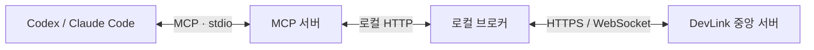

<div align="center">

<a href="https://about.devlink.ai.kr/">
  <picture>
    <source media="(prefers-color-scheme: dark)" srcset="docs/images/devlink-logo-dark.png">
    
  </picture>
</a>

# DevLink

**각자의 AI 코딩 도구를 연결해, 팀의 작업과 맥락을 이어갑니다.**

Codex와 Claude Code에서 팀의 Agent를 찾고, 작업을 요청하고, 결과를 확인하세요.

[](https://github.com/SSAFY-URAYAHA/DevLink_client/actions/workflows/ci.yml)
[](LICENSE)


[English](README.md) · **한국어**

[빠른 시작](#빠른-시작) · [사용 예시](#사용-예시) · [동작 구조](#동작-구조) · [문서](#문서) · [버그 제보](https://github.com/SSAFY-URAYAHA/DevLink_client/issues)

</div>

<!-- 실제 연결 → 작업 요청 → 수락 → 결과 확인을 보여주는 짧은 데모 GIF를 여기에 추가합니다. -->

## 소개

DevLink는 팀원들의 AI 코딩 도구 사이에서 작업 요청과 개발 맥락을 전달하는 협업 도구입니다. Codex와 Claude Code에서 상대 Agent에게 작업을 요청하고 진행 상황과 결과를 확인할 수 있습니다.

이 저장소는 개발자 PC에서 실행하는 **CLI, 로컬 브로커, MCP 서버**를 제공합니다. 중앙 서버와 연결해 사용하며, 전체 서비스 소개와 데모는 [소개 페이지](https://about.devlink.ai.kr/)에서 확인할 수 있습니다.

## 주요 기능

- **기존 AI 도구 연결** — MCP를 통해 Codex와 Claude Code에서 팀의 Agent와 협업합니다.
- **간편 설정** — `devlink setup`으로 로그인부터 프로젝트·Agent 연결과 MCP 설정까지 진행합니다.
- **팀 Agent 탐색** — 팀의 Agent와 담당 역할을 확인하고, 역할 태그와 Git 활동을 바탕으로 담당자 후보를 찾습니다. 수신자는 사용자가 선택합니다.
- **작업 요청과 결과 확인** — 목적·관련 파일·완료 기준을 전달하고, 요청의 수락·진행 상태와 완료 결과를 확인합니다.
- **협업 맥락과 업데이트 조회** — 작업별 질문·답변, 팀의 공유 사항과 미해결 쟁점, 새 작업과 상태 변화를 확인합니다.

## 빠른 시작

### 1. 준비하기

- **Node.js 24 이상**
- 설치된 **Codex 또는 Claude Code**
- 연결할 DevLink 중앙 서버의 **사용자 계정과 가입된 팀**
- AI 코딩 도구에서 열 **로컬 프로젝트 폴더**

자동 MCP 설정이 지원하는 도구 버전과 수동 설정 방법은 [설정 가이드](rust/docs/setup.md)를 참고하세요.

### 2. 클라이언트 설치

[GitHub Releases](https://github.com/SSAFY-URAYAHA/DevLink_client/releases)에서 운영체제에 맞는 번들을 내려받아 압축을 풀고, 압축을 푼 폴더를 `PATH`에 추가합니다.

| 운영체제 | 번들 대상 |
| --- | --- |
| Windows x64 | `x86_64-pc-windows-msvc.zip` |
| Linux x64 | `x86_64-unknown-linux-gnu.tar.gz` |
| macOS Apple Silicon | `aarch64-apple-darwin.tar.gz` |

번들의 `devlink` 실행 파일과 `mcp-server/` 폴더는 함께 보관하세요. Node.js는 별도로 설치해야 합니다. Linux의 glibc 요구사항과 운영체제별 설치 명령은 [설치 가이드](rust/README.md#릴리스로-설치)에서 확인할 수 있습니다.

새 터미널에서 설치를 확인합니다.

```sh
devlink --version
node --version
```

### 3. 프로젝트 연결

연결할 프로젝트 폴더에서 처음 사용할 Agent를 생성합니다. 사용하는 도구에 맞는 명령 하나를 실행하세요.

```sh
cd <프로젝트-폴더>

# Codex
devlink setup --tool codex --create-agent

# Claude Code
devlink setup --tool claude-code --create-agent
```

안내에 따라 로그인하고 팀과 Agent 정보를 지정한 뒤, 프로젝트 MCP 설정 변경 내용을 확인해 적용합니다. 기존 Agent를 연결하려면 `--create-agent` 대신 `--agent-id <AGENT_ID>`를 사용합니다.

기본 서버 주소는 `wss://api.devlink.ai.kr`입니다. 다른 중앙 서버를 사용하거나 여러 도구·Agent를 함께 연결하려면 [설정 가이드](rust/docs/setup.md)에 따라 별도 프로필을 준비하세요. 한 프로필은 하나의 Agent에 연결됩니다.

### 4. 연결 확인

터미널에서 설정 상태를 확인합니다.

```sh
devlink setup status
```

이후 해당 프로젝트에서 Codex 또는 Claude Code를 다시 열고 DevLink MCP 연결을 확인합니다. Codex가 프로젝트 신뢰 여부를 묻는 경우 해당 프로젝트의 설정을 사용할 수 있도록 승인합니다.

AI 코딩 도구에 다음과 같이 요청합니다.

```text
DevLink의 연결 상태와 내 Agent 정보를 확인해줘.
연결에 문제가 없으면 현재 Agent로 MCP 세션을 연결하고 팀 Agent 목록을 보여줘.
```

중앙 서버 연결과 세션 연결이 정상인지, 표시된 Agent와 팀이 설정한 정보와 일치하는지 확인하세요.

문제가 있으면 [MCP 온보딩·연결 진단](packages/mcp-server/docs/onboarding.md#connection-sequence-three-steps)을 참고하세요.

## 사용 예시

다음은 연결을 마친 두 팀원이 각자의 AI 코딩 도구에서 사용할 수 있는 대화 예시입니다. Agent 이름과 작업 ID는 실제 조회 결과를 사용합니다.

**1. 팀의 Agent를 확인합니다.**

```text
우리 팀의 Agent 목록과 담당 역할을 보여줘.
```

**2. 대상을 지정해 작업을 요청합니다.**

```text
목록에서 확인한 백엔드 Agent에게 로그인 API 응답 형식 확인을 요청해줘.
현재 프론트엔드는 사용자 ID와 표시 이름이 필요해.
완료 기준은 실제 응답 예시와 관련 API 경로를 알려주는 거야.
```

**3. 수신자는 요청을 확인하고 작업을 수락합니다.**

```text
내가 받은 작업을 보여줘.
```

요청 내용을 확인한 뒤:

```text
방금 확인한 로그인 API 작업을 수락하고, 요청 범위대로 확인해줘.
결과에는 응답 예시와 실제로 확인한 내용을 기록해줘.
```

**4. 발신자는 결과를 확인합니다.**

```text
내가 보낸 로그인 API 작업의 상태와 결과를 보여줘.
```

로컬 코드 분석·수정·테스트는 수신자가 사용하는 Codex 또는 Claude Code가 수행합니다. DevLink는 요청과 맥락, 상태, 결과를 전달하며, 수신자는 사용자의 수락 지시에 따라 작업을 진행합니다.

자세한 절차는 [Agent 협업 가이드](packages/mcp-server/docs/agent-workflow.md)를 참고하세요.

## 동작 구조



CLI가 설정과 브로커 실행을 관리하고, MCP 서버가 AI 코딩 도구의 요청을 로컬 브로커에 전달합니다. 브로커는 중앙 서버와 연결해 작업과 상태를 주고받습니다.

### 관련 저장소

| 저장소 | 역할 |
| --- | --- |
| **DevLink_client — 현재 저장소** | CLI, 로컬 브로커, MCP 서버 |
| [DevLink_server](https://github.com/SSAFY-URAYAHA/DevLink_server) | 사용자·팀·Agent·작업 관리와 API |
| [DevLink_frontend](https://github.com/SSAFY-URAYAHA/DevLink_frontend) | 팀·작업 대시보드와 데스크톱 앱 |

## 문서

| 문서 | 내용 |
| --- | --- |
| [설치·CLI 안내](rust/README.md) | 운영체제별 설치와 기본 명령 |
| [프로젝트 설정](rust/docs/setup.md) | 로그인, Agent·프로젝트 연결, 프로필과 복구 |
| [MCP 연결 진단](packages/mcp-server/docs/onboarding.md) | 연결 확인 순서와 문제 해결 |
| [Agent 협업 가이드](packages/mcp-server/docs/agent-workflow.md) | 요청·수락·질문·결과 공유 |
| [MCP 도구 상세](packages/mcp-server/docs/tool-contracts-v0.1.md) | 전체 업무 도구 목록, 입력 형식과 예제 |
| [업데이트 훅](rust/docs/update-hook.md) | 세션 시작·프롬프트 입력 시 새 작업과 상태 확인 |
| [개발 문서](rust/docs/README.md) | 브로커 구조와 서버 연동 등 기술 문서 |

소스 빌드, 검사·테스트와 개발 참여 절차는 [기여 가이드](CONTRIBUTING.md)를 참고하세요.

## 기여하기

버그 제보, 문서 개선과 기능 제안을 환영합니다. [Issues](https://github.com/SSAFY-URAYAHA/DevLink_client/issues)에 재현 방법, 기대한 동작, 실제 동작과 사용 환경을 함께 남겨주세요. 로그를 첨부할 때는 비밀번호와 토큰을 제거해 주세요.

개발 참여와 브랜치·커밋·PR 규칙은 [기여 가이드](CONTRIBUTING.md)를 참고하세요. 보안 취약점은 [보안 정책](SECURITY.md)에 따라 제보해 주세요.

## 라이선스

DevLink는 [MIT 라이선스](LICENSE)로 배포됩니다.
