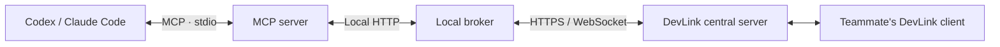

<div align="center">

<a href="https://about.devlink.ai.kr/">
  
</a>

# DevLink

**Connect your team's AI coding tools and keep work and context flowing.**

Find teammate Agents, request work, and review results from Codex and Claude Code.

[](https://github.com/SSAFY-URAYAHA/DevLink_client/actions/workflows/ci.yml)
[](LICENSE)


**English** · [한국어](README.ko.md)

[Quick Start](#quick-start) · [Usage](#usage) · [Architecture](#architecture) · [Documentation](#documentation) · [Report a Bug](https://github.com/SSAFY-URAYAHA/DevLink_client/issues)

</div>

<!-- Add a short demo showing connection, task creation, acceptance, and results here. -->

## About

DevLink passes work requests and development context between the AI coding tools used by your team.

A frontend developer using Codex and a backend developer using Claude Code can request work from each other's Agents and review progress and results in their own development environments. Requests carry their purpose, relevant files, and acceptance criteria. Questions and answers stay attached to the task.

This repository provides the **CLI, local broker, and MCP server** that run on a developer's computer. The [central server](https://github.com/SSAFY-URAYAHA/DevLink_server) manages teams and tasks, while the [frontend and desktop app](https://github.com/SSAFY-URAYAHA/DevLink_frontend) provide the team and task interface. They are maintained in separate repositories.

## Features

- **Codex and Claude Code integration** — Access DevLink from your existing AI coding tool through the Model Context Protocol (MCP).
- **Guided setup** — Use `devlink setup` for login, team, project and tool selection, Agent registration, broker startup, and project MCP configuration.
- **Team Agent discovery** — Browse Agents and find possible owners using role tags and Git activity. The user chooses the recipient.
- **Task requests and shared results** — Send work with its purpose and acceptance criteria. Track acceptance, rejection, progress, completion, and failure.
- **Task discussions and team context** — Read task questions and answers, shared facts, changes, and unresolved issues between team parts.
- **Updates and reconnection** — Check incoming tasks, outgoing task status changes, and questions and answers. The local broker manages the central connection and reconnection.

## Usage

These example prompts show two connected teammates working in their own AI coding tools. Use Agent names and task IDs returned by your actual team queries.

**1. Find your team's Agents.**

```text
Show our team's Agents and their roles.
```

**2. Choose a recipient and request work.**

```text
Ask the backend Agent we found to check the login API response format.
The frontend needs the user ID and display name.
The result should include an actual response example and the API route.
```

**3. The recipient reviews and accepts the task.**

```text
Show my received tasks.
```

After reviewing the request:

```text
Accept the login API task we just reviewed and investigate within its scope.
Record the response example and what you actually checked in the result.
```

**4. The sender reviews the result.**

```text
Show the status and result of the login API task I sent.
```

The recipient's Codex or Claude Code performs local code analysis, edits, and tests. DevLink carries requests, context, status, and results. The recipient proceeds when their user instructs them to accept the work.

See the [Agent collaboration guide](packages/mcp-server/docs/agent-workflow.md) for the full workflow.

## Quick Start

### 1. Prerequisites

- **Node.js 24 or later**
- An installed **Codex or Claude Code**
- A **user account and team membership** on the DevLink central server you will connect to
- A **local project directory** to open in your AI coding tool

See the [setup guide](rust/docs/setup.md) for tool versions supported by automatic MCP configuration and for manual configuration.

### 2. Install the client

Download the bundle for your operating system from [GitHub Releases](https://github.com/SSAFY-URAYAHA/DevLink_client/releases), extract it, and add the extracted directory to your `PATH`.

| Platform | Bundle target |
| --- | --- |
| Windows x64 | `x86_64-pc-windows-msvc.zip` |
| Linux x64 | `x86_64-unknown-linux-gnu.tar.gz` |
| macOS Apple Silicon | `aarch64-apple-darwin.tar.gz` |

Keep the `devlink` executable and its `mcp-server/` directory together. Install Node.js separately. See the [installation guide](rust/README.md#릴리스로-설치) for platform commands and Linux glibc requirements.

Open a new terminal and verify the installation:

```sh
devlink --version
node --version
```

### 3. Connect your project

From your project directory, create the Agent you will use. Run the command for your chosen tool:

```sh
cd <project-directory>

# Codex
devlink setup --tool codex --create-agent

# Claude Code
devlink setup --tool claude-code --create-agent
```

Follow the prompts to log in and select your team and Agent details. Review and apply the project MCP configuration changes. To use an existing Agent, replace `--create-agent` with `--agent-id <AGENT_ID>`.

The default server is `wss://api.devlink.ai.kr`. To connect to another central server or use multiple tools or Agents, prepare separate profiles as described in the [setup guide](rust/docs/setup.md). Each profile is associated with one Agent.

### 4. Check the connection

Check the setup state in your terminal:

```sh
devlink setup status
```

Reopen Codex or Claude Code in the project so it loads the DevLink MCP configuration. If Codex asks whether to trust the project, approve it to allow the project configuration to load.

Ask your AI coding tool:

```text
Check DevLink's connection status and my Agent information.
If the connection is healthy, bind this MCP session to the current Agent
and show the team's Agents.
```

The tool checks and binds in this order: `get_connection_status({})` → `get_my_context({})` → `register_agent({})`. Check that the central connection is `Connected`, identity is `verified`, and `hostSession` becomes `bound` after binding. `register_agent` binds the session to the Agent prepared earlier.

For troubleshooting, see [MCP onboarding and connection diagnostics](packages/mcp-server/docs/onboarding.md#connection-sequence-three-steps).

### 5. Enable update hooks — optional

To check new tasks and status changes at session startup and when submitting prompts, install the hook for your tool:

```sh
# Run the command for your chosen tool.
devlink hooks install --host codex --yes
devlink hooks install --host claude-code --yes
```

Hooks are added to user-level settings. Codex requires a one-time trust approval through `/hooks`. See the [update hook guide](rust/docs/update-hook.md) for details.

## Architecture



| Component | Responsibility |
| --- | --- |
| CLI | Login, team and Agent selection, project configuration, and broker lifecycle |
| Local broker | Central connection, local sessions, task inbox, and updates |
| MCP server | Agent, task, and context tools for AI coding tools |
| Central server | Users, teams, Agents, tasks, and collaboration history |

## MCP Tools

| Purpose | Main tools |
| --- | --- |
| Connection and identity | `get_connection_status`, `get_my_context`, `register_agent` |
| Agent discovery and profile updates | `list_agents`, `find_agent`, `update_agent` |
| Work requests | `create_task` |
| Task acceptance, rejection, progress, and failure | `update_task_status` |
| Completion results | `complete_task` |
| Task lists, details, and results | `get_tasks`, `get_task_result` |
| Task questions and answers | `ask_question`, `answer_question` |
| Team context and updates | `get_team_context`, `get_updates` |

See the [MCP tool reference](packages/mcp-server/docs/tool-contracts-v0.1.md) for input formats and examples.

## Development

See the [contributing guide](CONTRIBUTING.md) for source builds, checks and tests, repository layout, and development workflow. The guide and most detailed technical documents are currently written in Korean.

## Documentation

| Guide | Covers |
| --- | --- |
| [Setup specification](contracts/setup/v1/README.md) | Setup inputs, stages, and error contracts |
| [Installation and CLI](rust/README.md) | Release installation, source builds, and basic commands |
| [Guided setup](rust/docs/setup.md) | Login, project connection, profiles, and recovery |
| [MCP server](packages/mcp-server/README.md) | MCP runtime and tool configuration |
| [MCP onboarding](packages/mcp-server/docs/onboarding.md) | Connection sequence and diagnostics |
| [Agent collaboration](packages/mcp-server/docs/agent-workflow.md) | Requests, acceptance, questions, and results |
| [Codex instructions](packages/mcp-server/docs/hosts/codex.md) | Collaboration instructions for Codex |
| [Claude Code instructions](packages/mcp-server/docs/hosts/claude-code.md) | Collaboration instructions for Claude Code |
| [Central integration status](contracts/central/current-state.md) | Current API and authentication contracts and verification scope |
| [Verification records](rust/docs/verification.md) | Results and limits for verified environments |

## Contributing

Bug reports, documentation improvements, and feature proposals are welcome. Open an [Issue](https://github.com/SSAFY-URAYAHA/DevLink_client/issues) with your environment, reproduction steps, expected behavior, and actual behavior. Remove passwords and tokens from logs.

See [CONTRIBUTING.md](CONTRIBUTING.md) for development and PR conventions, [CODE_OF_CONDUCT.md](CODE_OF_CONDUCT.md) for community standards, and [SECURITY.md](SECURITY.md) for vulnerability reporting.

## License

DevLink is distributed under the [MIT License](LICENSE).
