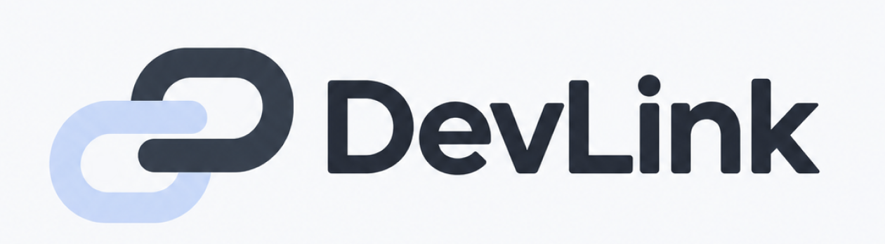
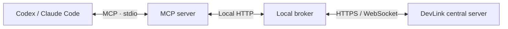

<div align="center">

<a href="https://about.devlink.ai.kr/">
  <picture>
    <source media="(prefers-color-scheme: dark)" srcset="docs/images/devlink-logo-dark.png">
    
  </picture>
</a>

# DevLink

**Connect your team's AI coding tools and keep work and context flowing.**

Find teammate Agents, request work, and review results from Codex and Claude Code.

[](https://github.com/SSAFY-URAYAHA/DevLink_client/actions/workflows/ci.yml)
[](LICENSE)


**English** · [한국어](README.ko.md)

[Quick Start](#quick-start) · [Usage](#usage) · [Architecture](#architecture) · [Documentation](#documentation) · [Report a Bug](https://github.com/SSAFY-URAYAHA/DevLink_client/issues)

</div>

<!-- Add a short demo showing connection, task creation, acceptance, and results here. -->

## About

DevLink connects your team's AI coding tools to share work requests and development context. From Codex and Claude Code, you can request work from teammate Agents and review progress and results.

This repository provides the **CLI, local broker, and MCP server** that run on a developer's computer and connect to the central server. Visit the [introduction page](https://about.devlink.ai.kr/) for the full service overview and demo.

## Features

- **Connect your existing AI tools** — Collaborate with teammate Agents from Codex and Claude Code through MCP.
- **Guided setup** — Use `devlink setup` to log in, connect your project and Agent, and configure MCP.
- **Discover teammate Agents** — Browse Agents and roles, and find possible owners using role tags and Git activity. The user chooses the recipient.
- **Request work and review results** — Share the purpose, relevant files, and acceptance criteria, then check acceptance, progress, and results.
- **Read context and updates** — Follow task questions and answers, shared team context, unresolved issues, incoming tasks, and status changes.

## Quick Start

### 1. Prerequisites

- **Node.js 24 or later**
- An installed **Codex or Claude Code**
- A **user account and team membership** on the DevLink central server you will connect to
- A **local project directory** to open in your AI coding tool

See the [setup guide](rust/docs/setup.md) for tool versions supported by automatic MCP configuration and for manual configuration.

### 2. Install the client

Download the bundle for your operating system from [GitHub Releases](https://github.com/SSAFY-URAYAHA/DevLink_client/releases), extract it, and add the extracted directory to your `PATH`.

| Platform | Bundle target |
| --- | --- |
| Windows x64 | `x86_64-pc-windows-msvc.zip` |
| Linux x64 | `x86_64-unknown-linux-gnu.tar.gz` |
| macOS Apple Silicon | `aarch64-apple-darwin.tar.gz` |

Keep the `devlink` executable and its `mcp-server/` directory together. Install Node.js separately. See the [installation guide](rust/README.md#릴리스로-설치) for platform commands and Linux glibc requirements.

Open a new terminal and verify the installation:

```sh
devlink --version
node --version
```

### 3. Connect your project

From your project directory, create the Agent you will use. Run the command for your chosen tool:

```sh
cd <project-directory>

# Codex
devlink setup --tool codex --create-agent

# Claude Code
devlink setup --tool claude-code --create-agent
```

Follow the prompts to log in and select your team and Agent details. Review and apply the project MCP configuration changes. To use an existing Agent, replace `--create-agent` with `--agent-id <AGENT_ID>`.

The default server is `wss://api.devlink.ai.kr`. To connect to another central server or use multiple tools or Agents, prepare separate profiles as described in the [setup guide](rust/docs/setup.md). Each profile is associated with one Agent.

### 4. Check the connection

Check the setup state in your terminal:

```sh
devlink setup status
```

Reopen Codex or Claude Code in the project so it loads the DevLink MCP configuration. If Codex asks whether to trust the project, approve it to allow the project configuration to load.

Ask your AI coding tool:

```text
Check DevLink's connection status and my Agent information.
If the connection is healthy, bind this MCP session to the current Agent
and show the team's Agents.
```

Confirm that the central connection and session binding are healthy, and that the Agent and team match your setup.

For troubleshooting, see [MCP onboarding and connection diagnostics](packages/mcp-server/docs/onboarding.md#connection-sequence-three-steps).

## Usage

These example prompts show two connected teammates working in their own AI coding tools. Use Agent names and task IDs returned by your actual team queries.

**1. Find your team's Agents.**

```text
Show our team's Agents and their roles.
```

**2. Choose a recipient and request work.**

```text
Ask the backend Agent we found to check the login API response format.
The frontend needs the user ID and display name.
The result should include an actual response example and the API route.
```

**3. The recipient reviews and accepts the task.**

```text
Show my received tasks.
```

After reviewing the request:

```text
Accept the login API task we just reviewed and investigate within its scope.
Record the response example and what you actually checked in the result.
```

**4. The sender reviews the result.**

```text
Show the status and result of the login API task I sent.
```

The recipient's Codex or Claude Code performs local code analysis, edits, and tests. DevLink carries requests, context, status, and results. The recipient proceeds when their user instructs them to accept the work.

See the [Agent collaboration guide](packages/mcp-server/docs/agent-workflow.md) for the full workflow.

## Architecture



The CLI manages configuration and the broker lifecycle. The MCP server passes requests from your AI coding tool to the local broker, which exchanges tasks and status with the central server.

### Related repositories

| Repository | Responsibility |
| --- | --- |
| **DevLink_client — this repository** | CLI, local broker, and MCP server |
| [DevLink_server](https://github.com/SSAFY-URAYAHA/DevLink_server) | User, team, Agent, and task management and APIs |
| [DevLink_frontend](https://github.com/SSAFY-URAYAHA/DevLink_frontend) | Team and task dashboard and desktop app |

## Documentation

| Guide | Covers |
| --- | --- |
| [Installation and CLI](rust/README.md) | Platform installation and basic commands |
| [Project setup](rust/docs/setup.md) | Login, Agent and project connection, profiles, and recovery |
| [MCP connection diagnostics](packages/mcp-server/docs/onboarding.md) | Connection checks and troubleshooting |
| [Agent collaboration](packages/mcp-server/docs/agent-workflow.md) | Requests, acceptance, questions, and results |
| [MCP tool reference](packages/mcp-server/docs/tool-contracts-v0.1.md) | Full business tool list, input formats, and examples |
| [Update hooks](rust/docs/update-hook.md) | Checking tasks and status at session startup and prompt submission |
| [Technical documentation](rust/docs/README.md) | Broker architecture, server integration, and other technical guides |

See the [contributing guide](CONTRIBUTING.md) for source builds, checks, tests, and development workflow. The guide and most detailed technical documents are currently written in Korean.

## Contributing

Bug reports, documentation improvements, and feature proposals are welcome. Open an [Issue](https://github.com/SSAFY-URAYAHA/DevLink_client/issues) with your environment, reproduction steps, expected behavior, and actual behavior. Remove passwords and tokens from logs.

See [CONTRIBUTING.md](CONTRIBUTING.md) for development and PR conventions, and [SECURITY.md](SECURITY.md) for vulnerability reporting.

## License

DevLink is distributed under the [MIT License](LICENSE).
